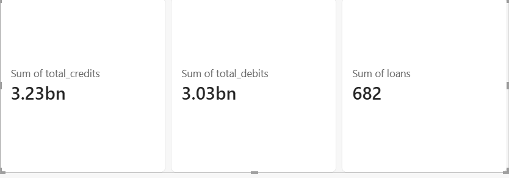
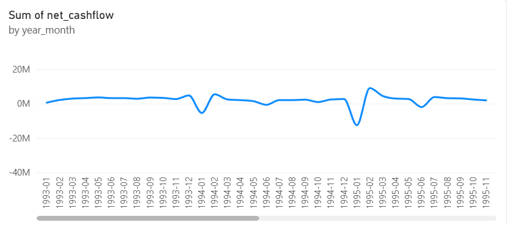
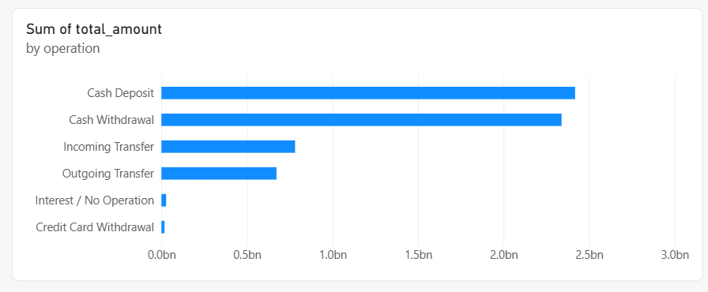
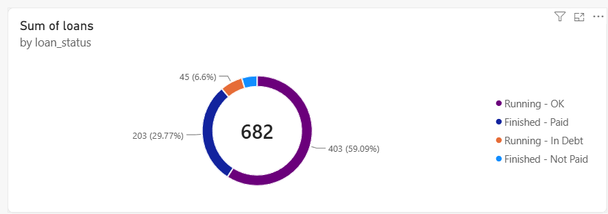
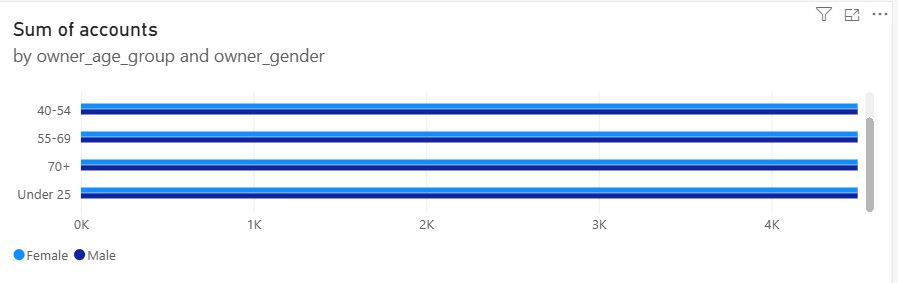

# Berka Bank Data Project

This project takes the raw data of a Czech bank (1993 to 1998), cleans it step by step in SQL Server, checks the numbers at every step, and shows the results in a Power BI dashboard.

## What I used

SQL Server Express, Python (pandas, SQLAlchemy, pyodbc), Power BI Desktop, sqlcmd, Git and GitHub, VS Code.

## How the data flows

CSV files -> Bronze -> Silver -> Gold -> Power BI

- Bronze: an untouched copy of the raw data. The big transactions file was loaded directly into SQL Server. The other 7 files were loaded with a small Python script (python/load_bronze.py).
- Silver: the cleaned version. Dates stored as text (like 930105) became real dates, Czech words became English, empty cells were made consistent, and I added a signed amount column so money going out shows as negative and money coming in shows as positive.
- Gold: the final tables built for reporting, such as one table for dates, one for accounts, one for clients, one for districts, plus tables for transactions and loans. Power BI reads only from here.

## The data

- Transactions: 1,056,320
- Accounts: 4,500
- Clients: 5,369
- Dispositions (who can use which account): 5,369
- Districts: 77
- Loans: 682
- Cards: 892
- Standing orders: 6,471

## Problems I found and how I fixed them

- Dates were stored as plain text in YYMMDD form. I added the century and converted them to real dates. No date was invalid.
- The amount column was always positive, and only the type column said whether it was money in or money out. I added a signed amount column so totals come out right.
- Many labels were in Czech (for example PRIJEM, VYDAJ, SIPO, UVER). I translated all of them to English.
- Some cells were empty text and some were truly empty. I made them all the same. All 183,114 transactions without an operation turned out to be interest payments.
- Client gender and birth date are hidden inside one birth number (for women, 50 is added to the month). I decoded both, and also worked out age and age group at the end of the data (31 December 1998).

## How I checked my work

- The number of rows matched at every step (1,056,320 transactions from start to finish).
- No invalid dates, and no broken links between tables. Every transaction belongs to an account, and every account has a district and an owner.
- The total net amount came out the same in four different places: 197,151,288.70.
- After translating, I checked that no Czech words or empty text were left.
- Every script can be run again from scratch without errors.

## Main numbers

- 1,056,320 transactions across 4,500 accounts
- Total money in: 3.23 billion. Total money out: 3.03 billion.
- 682 loans, and 76 of them (about 11 percent) are bad: 31 finished without being fully paid, and 45 are running in debt.

## Dashboard

The dashboard shows the main numbers on cards, monthly net cashflow, the amount by type of operation, how loans are split by status, and the number of accounts by age group and gender.

A PDF copy of the dashboard is in powerbi/Berka_Dashboard.pdf.

## Folders

- sql/bronze: checks on the raw data
- sql/silver: cleaning scripts and their checks
- sql/gold: reporting tables, views and their checks
- python: the script that loads the 7 smaller files
- powerbi: the dashboard file, the PDF and screenshots
- data: the original CSV files (not uploaded to GitHub because they are large)

## The SQL scripts

- sql/bronze/01_bronze_validation.sql: row count and key checks on the raw transactions
- sql/bronze/02_bronze_profiling.sql: column types, empty values, distinct values, dates and amounts
- sql/silver/01_silver_transactions.sql: builds the clean transactions table
- sql/silver/02_silver_transaction_validation.sql: checks the clean transactions table
- sql/silver/03_silver_reference_table.sql: builds the 7 smaller clean tables
- sql/silver/04_silver_reference_validation.sql: checks the 7 smaller tables
- sql/gold/01_gold_transactions.sql: dates, accounts, transactions and monthly views
- sql/gold/02_gold_validation.sql: checks that gold matches silver
- sql/gold/03_gold_reference.sql: districts, clients, loans and the account, loan, district and customer views

## How to run it

1. Create the database Berka_banking_analytics in SQL Server with three schemas: bronze, silver and gold.
2. Load trans.csv into bronze.transactions.
3. Put the other 7 CSV files in the data folder and run:

   pip install pandas sqlalchemy pyodbc
   python python/load_bronze.py

4. Run the SQL scripts in this order: silver 01, 02, 03, 04, then gold 01, 02, 03. Each one runs with:

   sqlcmd -S .\SQLEXPRESS01 -d Berka_banking_analytics -E -C -i <script file>

5. Open powerbi/Berka_Dashboard.pbix and refresh the data.

## What I learned

- How to keep raw, cleaned and report-ready data in separate layers
- How to check the numbers after every step so nothing gets lost quietly
- How to clean messy real-world data: text dates, foreign-language labels, empty cells and hidden information
- How to fix problems with the tools themselves, such as server names, saved files and scripts that fail halfway
- How to build a dashboard on top of clean data